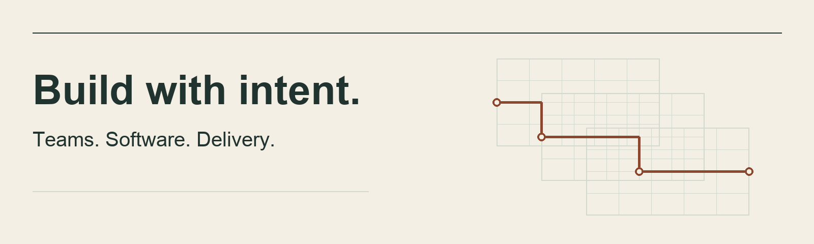

<picture>
  <source media="(max-width: 600px)" srcset="./assets/cover-mobile.png">
  
</picture>

# Christopher Long

**Engineering leadership · Software architecture · AI-assisted delivery**

I’m Christopher “Chris” Long, Director of Engineering at [Empath](https://empathmsp.com/), a learning platform for managed service providers (MSPs), and previously Chief Technology Officer (CTO) at Sensorydata.

Based in San Diego, I build engineering teams and production software across SaaS, digital health, and connected devices.

> **Ownership does not transfer to the machine.**
> Engineers direct AI agents, evaluate their output, and own delivery and the bugs that follow.

[Career background on LinkedIn](https://www.linkedin.com/in/chrislong365/) · [Meet the Empath team](https://empathmsp.com/about-us)

## Selected experience

### Empath — Director of Engineering

*April 2024–present*

I joined as the first in-house engineer and brought development in-house from an outside agency. I built the engineering function as the business grew from under $60K in annual revenue to over $1.7M in annual recurring revenue (ARR). I now lead five engineers, owning strategy, hiring, architecture, design, and delivery alongside hands-on code.

My engineering work includes identity-provider replacement under live traffic, a phased DynamoDB-to-PostgreSQL migration with old and new behavior compared before switching each domain, and partner tenancy with seat pools and catalogue entitlements.

### Sensorydata — CTO

*May 2019–April 2024*

I led development and launch of **InterPIP**, an international clinical guideline app that reached **3,600+ registered users across 13 localizations**. I also led cloud and mobile development for smart-textile pressure sensing, including time-series data and Bluetooth-connected devices.

### FemGevity — Fractional CTO

*November 2022–January 2024*

I connected electronic health records, scheduling, payments, and patient communications through serverless APIs and business automations.

## AI-assisted engineering, human ownership

At Empath, I built a documented 22-station delivery process with independent review and a human on every merge. Product decisions are made with product, the founders, and customers.

- **Resolve ambiguity before implementation.** Define the problem, plan, acceptance criteria, QA, and design before assigning work.
- **Find the mechanism before the fix.** Replace a guess with evidence, especially when changing systems under live traffic.
- **Know when to stop.** Cancelling work that will buy nothing is an engineering decision worth making.

## Tools I work with

TypeScript · React · Bun · PostgreSQL · Prisma · Redis · AWS · Terraform

---

**Let’s talk engineering, product, or practical AI.** [Connect on LinkedIn →](https://www.linkedin.com/in/chrislong365/)

Updated November 2026.
